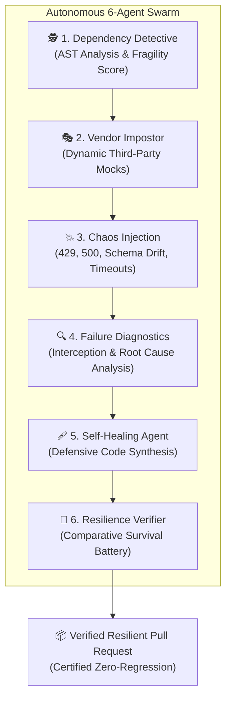

# 👻 GhostVendor

> *"GhostVendor haunts your dependencies. Six AI agents impersonate your vendors, inject chaos, find what breaks, fix the code, and only open a PR when the patch is proven to survive."*

---

## 🌟 Overview

**GhostVendor** is an autonomous multi-agent developer system for software supply-chain resilience and chaos engineering. 

Modern applications constantly integrate external services (Stripe, SendGrid, Auth0, OpenAI, Twilio). When external vendors introduce unexpected schema drifts, change payload formats, throttle requests with HTTP 429, or experience downtime, downstream applications crash.

GhostVendor proactively stress-tests application merge requests before they reach production:
1. Detects external dependencies via static AST analysis.
2. Impersonates vendor endpoints and injects realistic failure modes (chaos engineering).
3. Intercepts crashes and stack traces in a sandboxed test harness.
4. Synthesizes production-grade defensive self-healing patches (circuit breakers, exponential backoff, alias guards, safe traversal).
5. Executes comparative survival test batteries to certify zero regressions.
6. Packages remediation into ready-to-merge GitLab Duo / GitHub Pull Requests.

---

## 🏛️ System Architecture



---

## 🚀 Getting Started

### 1. Prerequisites
- Python 3.10+
- Streamlit (`pip install streamlit`)

### 2. Run the Interactive Streamlit Web App
Launch the full web dashboard:
```bash
streamlit run ghostvendor/app.py
```
Open your browser at `http://localhost:8501`.

### 3. Run the CLI Runner
Execute an automated resilience test directly from your command line:
```bash
# Test Stripe payments
python ghostvendor/cli.py --scenario "Stripe Payment Processing"

# Test SendGrid email notifications
python ghostvendor/cli.py --scenario "SendGrid Notification Service"

# Test Auth0 user synchronization
python ghostvendor/cli.py --scenario "Auth0 User Profile Sync"
```

### 4. Run the Test Suite
```bash
python -m pytest ghostvendor/tests/test_agents.py -v
```

---

## 📁 Repository Structure

```text
ghostvendor/
├── app.py                   # Streamlit interactive UI application
├── cli.py                   # Command-line interface runner
├── requirements.txt         # Python dependencies
├── README.md                # Project documentation
├── agents/
│   ├── detector.py          # Agent 1: Static AST Dependency & Risk Detective
│   ├── impostor.py          # Agent 2: Dynamic Vendor Impostor Factory
│   ├── chaos.py             # Agent 3: Chaos Injection Engine
│   ├── diagnostics.py       # Agent 4: Failure Diagnostic & Interception
│   ├── self_healer.py       # Agent 5: Self-Healing Patch Synthesizer
│   ├── verifier.py          # Agent 6: Resilience Verifier & Stress Matrix
│   └── pr_generator.py      # Automated PR Markdown Formatter
├── scenarios/
│   └── samples.py           # Preloaded real-world target scenarios (Stripe, SendGrid, Auth0, OpenAI)
└── tests/
    └── test_agents.py       # Full automated test battery
```

---

## 🌐 Deploying to Streamlit Community Cloud (`streamlit.app`)

1. Push this folder to a GitHub repository.
2. Navigate to [share.streamlit.io](https://share.streamlit.io).
3. Connect your GitHub account and select the repository.
4. Set the **Main file path** to `ghostvendor/app.py`.
5. Click **Deploy!**
